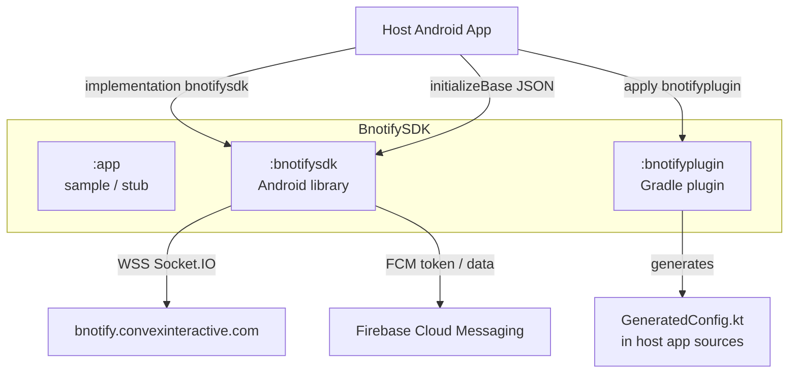
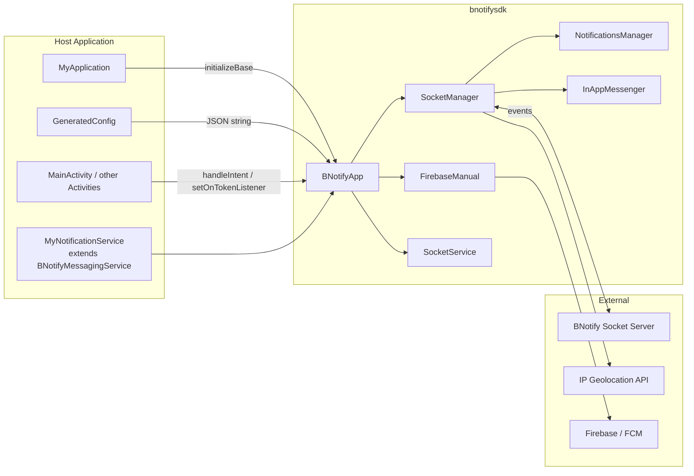
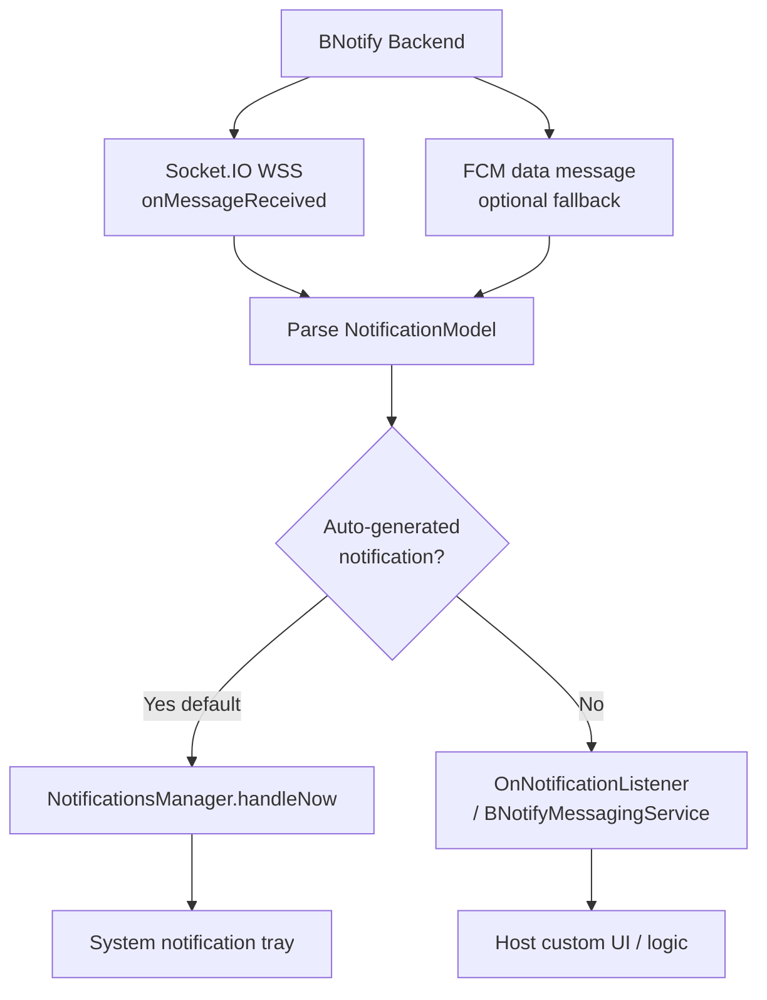
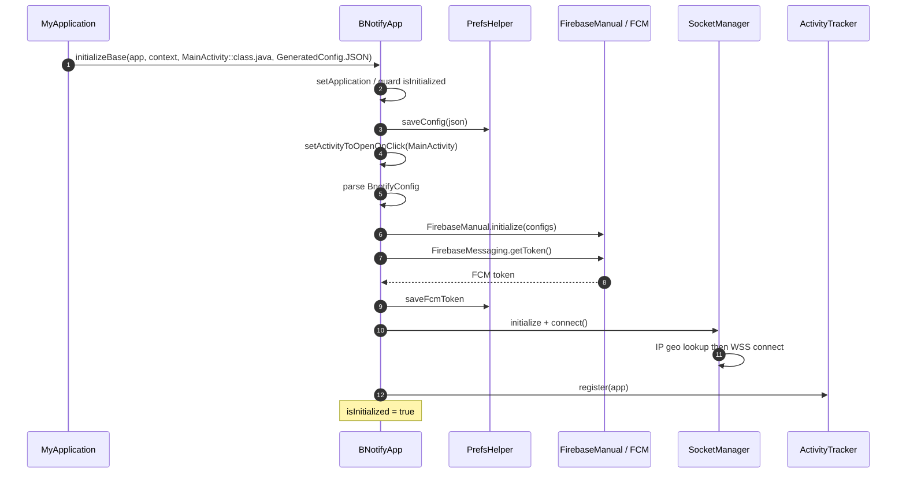
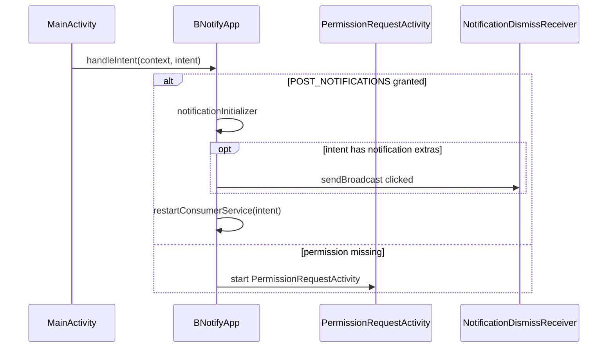
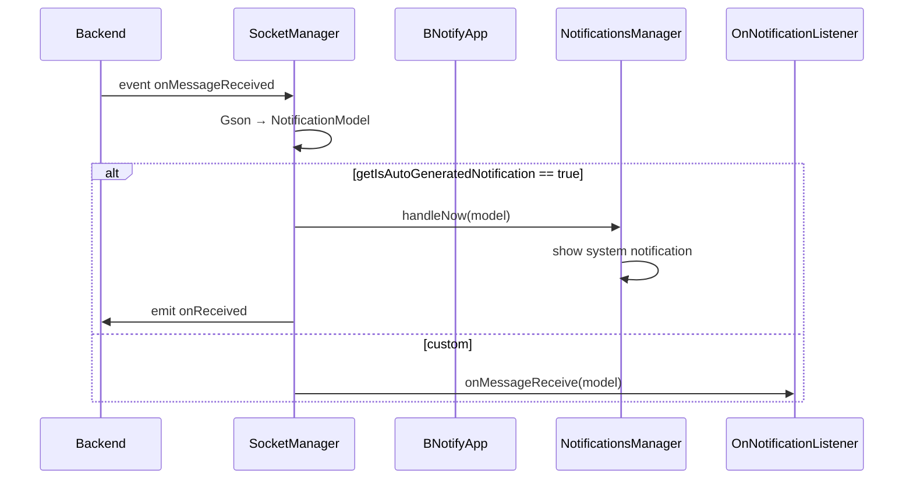
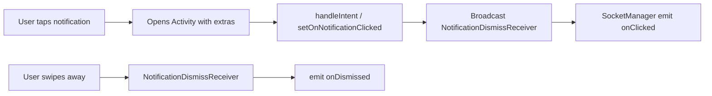
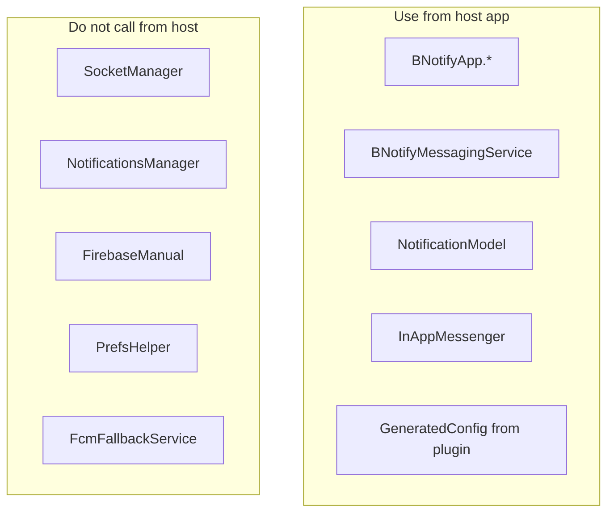
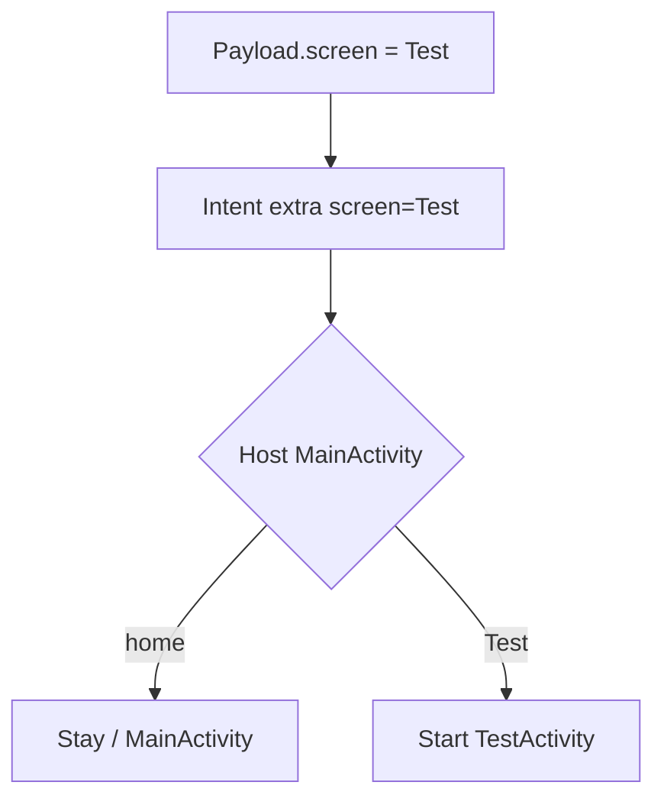
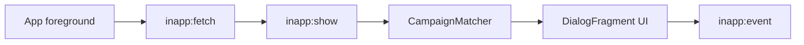

# BNotify Android SDK — Architecture & Code Documentation

> **Package / modules:** `bnotifysdk` (library) · `bnotifyplugin` (Gradle plugin)  
> **Maven coordinates (intended):** `com.github.bnotify.bnotifysdk:bnotifysdk:1.0.5`  
> **Plugin ID:** `com.github.bnotifysdk.bnotifyplugin`  
> **Namespace:** `com.convex.bnotifysdk`  
> **minSdk:** 24 · **compileSdk:** 36 · **Kotlin:** 2.0.x · **Version:** 1.0.5  
> **Distribution:** JitPack / local Maven (`build/repo`)  
> **Related:** [integration.md](integration.md)

This document describes how the Android BNotify SDK is structured, how push and in-app messaging work, and what every major class/module does — in written form and with diagrams.

---

## Table of Contents

1. [Overview](#1-overview)
2. [Repository Structure](#2-repository-structure)
3. [High-Level Architecture](#3-high-level-architecture)
4. [Delivery Channels (Socket.IO + FCM)](#4-delivery-channels-socketio--fcm)
5. [Initialization & Runtime Flows](#5-initialization--runtime-flows)
6. [Gradle Plugin (`bnotifyplugin`)](#6-gradle-plugin-bnotifyplugin)
7. [Core Modules & Classes](#7-core-modules--classes)
8. [Public API Surface](#8-public-api-surface)
9. [Data Models](#9-data-models)
10. [Networking & Events](#10-networking--events)
11. [Notification Display & Click Routing](#11-notification-display--click-routing)
12. [In-App Messaging](#12-in-app-messaging)
13. [Manifest, Permissions & Components](#13-manifest-permissions--components)
14. [Dependencies](#14-dependencies)
15. [Persistence (SharedPreferences)](#15-persistence-sharedpreferences)
16. [Threading & Lifecycle](#16-threading--lifecycle)
17. [Known Gaps & Notes](#17-known-gaps--notes)
18. [Glossary](#18-glossary)

---

## 1. Overview

BNotify Android SDK is a **client library** that:

1. Loads project config from a generated `GeneratedConfig` (via Gradle plugin + `bnotify-config.json`)
2. Initializes **Firebase Messaging manually** (no `google-services.json` required in the host app for SDK init)
3. Connects to the BNotify backend over **Socket.IO (WSS)** and registers the device with rich metadata + FCM token
4. Receives push payloads over the socket (primary) and optionally via **FCM data messages** (fallback / wake)
5. Shows system notifications (auto) or forwards payloads to the host app (custom)
6. Tracks **received / clicked / dismissed** events back to the server over the socket
7. Supports **In-App Messaging** campaigns (modal, card, banner, fullscreen, image)

### What the SDK does **not** do alone

| Capability | Who does it |
|------------|-------------|
| Compose & send campaigns / pushes | BNotify **backend / admin** |
| Host screen navigation (`screen=Test`) | **Host app** (e.g. open `TestActivity`) |
| Full Firebase Analytics / Crashlytics product SDK | Not included as product analytics |
| iOS APNs | Separate iOS SDK |

**Mental model:** Socket.IO-first realtime push client + optional FCM fallback + in-app messaging + build-time config plugin.

---

## 2. Repository Structure

```
BnotifySDK/
├── settings.gradle.kts              # Includes :app, :bnotifysdk, :bnotifyplugin
├── build.gradle.kts
├── gradle/
│   ├── libs.versions.toml
│   └── wrapper/
├── documentation.md                 # This file
├── integration.md                   # Host-app integration guide
├── app/                             # Local sample / stub app module
├── bnotifyplugin/                   # Gradle plugin → GeneratedConfig.kt
│   └── src/main/java/com/convex/bnotifyplugin/
│       └── MainGradlePlugin.kt
└── bnotifysdk/                      # Android library published as bnotifysdk
    ├── build.gradle.kts             # maven-publish → com.github.bnotify:bnotifysdk
    ├── src/main/AndroidManifest.xml
    └── src/main/java/com/convex/bnotifysdk/
        ├── BNotifyApp.kt            # Public facade
        ├── config/                  # GeneratedConfig stub + helpers
        ├── model/                   # Config, Notification, Token models
        ├── socket/                  # SocketManager
        ├── services/                # SocketService, BNotifyMessagingService, FCM
        ├── notification/            # NotificationsManager
        ├── receiver/                # NotificationDismissReceiver
        ├── activity/                # PermissionRequestActivity
        ├── network/                 # IPFinder, NetworkMonitor
        ├── utils/                   # PrefsHelper, NotifyConstants
        └── inappmessaging/          # In-app campaigns UI + storage
```



---

## 3. High-Level Architecture



### Architectural patterns

| Pattern | Usage |
|---------|--------|
| Singleton facade | `BNotifyApp` |
| Dual delivery | Socket.IO primary + FCM fallback |
| Build-time config embedding | `bnotifyplugin` → `GeneratedConfig` |
| Strategy for display | Auto (`NotificationsManager`) vs custom (`OnNotificationListener`) |
| Abstract host service | `BNotifyMessagingService` for click target + message callback |
| Lifecycle tracker | `ActivityTracker` for in-app foreground fetch |

---

## 4. Delivery Channels (Socket.IO + FCM)



| Channel | Role |
|---------|------|
| **Socket.IO** | Primary realtime path; device registration via handshake query; push + in-app + analytics events |
| **FCM** | Token collected for server; data messages / ping can wake or deliver when socket is offline |

There is **no REST `/devices/register`** call like the iOS SDK. Device “registration” is the Socket.IO connection query + `registered` event.

---

## 5. Initialization & Runtime Flows

### 5.1 Base init (`Application.onCreate`)



### 5.2 Activity intent handling



### 5.3 Incoming push (socket)



### 5.4 Click / dismiss analytics



---

## 6. Gradle Plugin (`bnotifyplugin`)

**Module:** `:bnotifyplugin`  
**Class:** `com.convex.bnotifyplugin.MainGradlePlugin`  
**Plugin ID:** `com.github.bnotifysdk.bnotifyplugin`  
**Published as:** `com.github.bnotify.bnotifysdk:bnotifyplugin:1.0.5` (JitPack) / `com.github.bnotify:bnotifyplugin:1.0.5` (flat)

### What it does

1. On apply, registers Gradle task `generateConfig`
2. Makes all `compile*` tasks depend on `generateConfig`
3. Reads **`{project.rootDir}/app/bnotify-config.json`** (path is hardcoded to the `app` folder)
4. Validates required JSON fields via kotlinx.serialization `BNotifyConfig`
5. Writes:

```text
{module}/src/main/java/{applicationId/as/path}/config/GeneratedConfig.kt
```

### Generated object shape

```kotlin
package {applicationId}.config

object GeneratedConfig {
    val JSON: String? = "{...full json escaped...}"
    val projectId: String? = "..."
    val packageName: String? = "..."
    val apiKey: String? = "..."
    val authDomain: String? = "..."
    val databaseURL: String? = "..."
    val storageBucket: String? = "..."
    val messagingSenderId: String? = "..."
    val appId: String? = "..."
    val measurementId: String? = "..."
    val fcmAppId: String? = "..."
    val fcmProjectId: String? = "..."
    val fcmApiKey: String? = "..."
    val fcmSenderId: String? = "..."
}
```

Host apps pass `GeneratedConfig.JSON.toString()` into `BNotifyApp.initializeBase(...)`.

> The library also ships a stub `com.convex.bnotifysdk.config.GeneratedConfig` with nulls — **do not use that in the host app**. Use the plugin-generated class under your `applicationId.config` package.

---

## 7. Core Modules & Classes

### 7.1 `BNotifyApp` — public facade

**File:** `bnotifysdk/.../BNotifyApp.kt`  
**Type:** `object` (singleton)

| API | Purpose |
|-----|---------|
| `initializeBase(app, context, activity, json)` | Application-level init: config, Firebase, FCM token, socket, ActivityTracker |
| `handleIntent(context, intent)` | Activity-level: permission check, click analytics, restart consumer service |
| `setActivityToOpenOnClick(activity)` | Default Activity opened when notification is tapped |
| `setIsAutoGeneratedNotification(context, enable)` | Toggle SDK system notification vs host callback |
| `setNotificationListener(listener)` | Receive `NotificationModel` when auto UI is off |
| `setOnTokenListener(listener)` | Callback when BNotify device token arrives (`registered` socket event) |
| `setOnNotificationReceived(model)` | Manually emit received analytics if socket connected |
| `setOnNotificationDismissed(...)` | Build dismiss `PendingIntent` + wire dismiss analytics |
| `setOnNotificationClicked(context, intent)` | Emit click analytics via broadcast when socket connected |

**Interfaces:**

```kotlin
interface OnNotificationListener {
    fun onMessageReceive(remoteMessage: NotificationModel?)
}

interface OnTokenListener {
    fun onNewToken(token: String?)
}
```

> **Token note:** `OnTokenListener` reports the **BNotify socket registration token**, not the raw FCM registration token. FCM token is stored in prefs / `SocketManager.FCM_TOKEN` for the handshake.

---

### 7.2 `BNotifyMessagingService`

**File:** `services/BNotifyMessagingService.kt`  
**Type:** `abstract class` extending `Service` (not `FirebaseMessagingService`)

Host must implement:

```kotlin
abstract fun activityToOpenOnClick(): Class<out Activity>
abstract fun onMessageReceived(remoteMessage: NotificationModel?)
```

**Behavior:**

- `onCreate`: sets click Activity from override (or manifest meta-data `berry.activity_on_click`)
- `onStartCommand`: registers `OnNotificationListener` → host `onMessageReceived`, runs `notificationInitializer`, returns `START_STICKY`

Host declares a concrete subclass in its own `AndroidManifest.xml` (and typically wires FCM if using fallback service).

---

### 7.3 `SocketManager` (internal)

**File:** `socket/SocketManager.kt`

| Concern | Detail |
|---------|--------|
| Host | `wss://bnotify.convexinteractive.com` |
| Before connect | IP / geo via Retrofit (`IPFinder`) |
| Handshake | Query params: `projectId`, `appId`, `fcmtoken`, device uuid, IP, locale, OS, app version, etc. |
| Listen | `onMessageReceived`, `inapp:show`, `registered` |
| Emit | `onReceived`, `onClicked`, `onDismissed`, `inapp:fetch`, `inapp:event` |
| Reconnect | Manual backoff, max 5 attempts |
| Offline | Pending emit queue until connected |

---

### 7.4 `NotificationsManager` (internal)

**File:** `notification/NotificationsManager.kt`

- Channel ID: `bnotify_channel` (HIGH importance, lights, vibration)
- Builds `NotificationCompat` with title/message
- Click `PendingIntent` → `getActivityToOpenOnClick()` with extras (`screen`, `notification_id`, `action=clicked`, `token`, `type`, …)
- Optional big-picture via **Glide** when `imageUrl` is a valid http(s) image URL
- Delete intent → `NotificationDismissReceiver`
- After show → socket `onReceived`

---

### 7.5 Firebase layer

| Class | Role |
|-------|------|
| `FirebaseManual` | Builds `FirebaseOptions` from `fcmApiKey`, `fcmAppId`, `fcmProjectId`, `fcmSenderId` if no default `FirebaseApp` |
| `FcmFallbackService` | Internal FCM service path for data / ping (host must declare if used) |

No `google-services` Gradle plugin is required for SDK initialization.

---

### 7.6 Supporting components

| Class | Role |
|-------|------|
| `SocketService` | Bound/started service keeping socket-related work alive (`exported=false`) |
| `PermissionRequestActivity` | Transparent activity to request `POST_NOTIFICATIONS` (API 33+) |
| `NotificationDismissReceiver` | Handles dismiss / click broadcasts → socket analytics |
| `PrefsHelper` | Config JSON, FCM token, auto-notification flag |
| `NotifyConstants` | Extra key / event name constants |
| `IPFinder*` | Geolocation lookup for socket metadata |
| `NetworkMonitor` | Connectivity helper (present; not always started in current flow) |
| `SocketWorker` | WorkManager worker (present; not scheduled by default path) |
| `ActivityTracker` | Activity lifecycle → in-app `inapp:fetch` on foreground |

---

## 8. Public API Surface



### Recommended host call order

```text
1. Application.onCreate
      BNotifyApp.initializeBase(this, this, MainActivity::class.java, GeneratedConfig.JSON.toString())

2. MainActivity.onCreate / onNewIntent
      BNotifyApp.handleIntent(applicationContext, intent)
      BNotifyApp.setOnTokenListener { token -> ... }

3. Optional screen routing from intent extras ("screen")
      BNotifyApp.setActivityToOpenOnClick(TargetActivity::class.java)

4. Optional MyNotificationService : BNotifyMessagingService()
```

---

## 9. Data Models

### 9.1 `BnotifyConfig`

```kotlin
data class BnotifyConfig(
    val projectId: String,
    val packageName: String,
    val apiKey: String,
    val authDomain: String? = null,
    val databaseURL: String? = null,
    val storageBucket: String? = null,
    val messagingSenderId: String? = null,
    val appId: String,
    val measurementId: String? = null,
    val fcmAppId: String,
    val fcmProjectId: String,
    val fcmApiKey: String,
    val fcmSenderId: String,
)
```

### 9.2 `NotificationModel`

| Field | Meaning |
|-------|---------|
| `title` / `message` | Notification text |
| `notificationId` | Unique id for analytics / PendingIntent |
| `token` | Tracking / device token for events |
| `screen` | Host routing hint (e.g. `home`, `Test`) |
| `type` | Payload type |
| `imageUrl` | Optional big-picture image |
| `isExpanded` | Expanded image style flag |
| `deliveryMethod` | How message was delivered |
| `action` | Action hint |
| `deepLink` | Present on model; host/in-app may use — system tray path primarily uses `screen` |
| `projectId` / `appId` | Project scoping |
| `eventTracking` / `preventDuplicate` / `socketOffline` | Behavior flags |

### 9.3 `BNotifyTokenModel`

Used when socket emits `registered` — supplies the BNotify token passed to `OnTokenListener`.

### 9.4 Config JSON (`app/bnotify-config.json`)

```json
{
  "projectId": "your-project-id",
  "packageName": "com.yourcompany.yourapp",
  "apiKey": "your-api-key",
  "authDomain": "optional",
  "databaseURL": "optional",
  "storageBucket": "optional",
  "messagingSenderId": "optional",
  "appId": "your-app-id",
  "measurementId": "optional",
  "fcmAppId": "1:...:android:...",
  "fcmProjectId": "your-fcm-project",
  "fcmApiKey": "AIza...",
  "fcmSenderId": "123456789"
}
```

**Required for plugin decode:** `projectId`, `packageName`, `apiKey`, `appId`, `fcmAppId`, `fcmProjectId`, `fcmApiKey`, `fcmSenderId`.

---

## 10. Networking & Events

### Endpoints / hosts

| Kind | URL / channel | Purpose |
|------|----------------|---------|
| Socket.IO | `wss://bnotify.convexinteractive.com` | Push, register, analytics, in-app |
| Geo IP | `https://ffmpegimages.mjunoon.tv/geolocation/public/api/ipdetails` | Connect metadata |
| FCM | Google FCM | Token + optional data delivery |

### Socket listen events

| Event | Handler purpose |
|-------|-----------------|
| `onMessageReceived` | Incoming push payload |
| `inapp:show` | Deliver in-app campaign JSON |
| `registered` | Device registered → BNotify token callback |

### Socket emit events

| Event | When |
|-------|------|
| `onReceived` | Notification displayed / received |
| `onClicked` | User opened notification |
| `onDismissed` | User dismissed notification |
| `inapp:fetch` | App foreground / fetch campaigns |
| `inapp:event` | In-app impression / click / dismiss |

---

## 11. Notification Display & Click Routing

### Auto display extras on click Intent

Typical extras attached by `NotificationsManager`:

| Extra | Example / notes |
|-------|-----------------|
| `from` | `notification` |
| `screen` | from payload (host routing) |
| `action` | `clicked` |
| `notification_id` | id |
| `type` | payload type |
| `token` | tracking token |
| `click` | `true` |

Flags commonly include `FLAG_ACTIVITY_NEW_TASK | FLAG_ACTIVITY_CLEAR_TOP`.

### Host screen routing (not done inside SDK)

```kotlin
val screen = intent.getStringExtra("screen")
when {
    screen.equals("home", true) ->
        BNotifyApp.setActivityToOpenOnClick(MainActivity::class.java)
    screen.equals("Test", true) -> {
        BNotifyApp.setActivityToOpenOnClick(TestActivity::class.java)
        startActivity(Intent(this, TestActivity::class.java))
        finish()
    }
}
```



---

## 12. In-App Messaging

**Entry:** `InAppMessenger` (+ fragments, matcher, storage, renderer)

| Piece | Role |
|-------|------|
| `InAppMessenger` | Init, log events, enqueue campaign, CTA / dismiss / impression |
| `CampaignFetcher` / `CampaignMatcher` | Fetch & match by trigger event |
| `CampaignStorage` | Local campaign cache / frequency |
| `MessageRenderer` | Choose UI by campaign type |
| Fragments | `Modal`, `Card`, `TopBanner`, `Fullscreen`, `Image` |
| `ActivityTracker` | Foreground → `inapp:fetch` |

**Campaign UI types:** `modal`, `card`, `top_banner`, `fullscreen`, `image`  
**CTA actions (typical):** `open_url`, `deeplink`, `custom_event`  
**Analytics types:** `impression`, `click_primary`, `click_secondary`, `dismissed`



---

## 13. Manifest, Permissions & Components

### Library permissions (`bnotifysdk` manifest)

- `INTERNET`
- `POST_NOTIFICATIONS`
- `VIBRATE`
- `ACCESS_NETWORK_STATE`
- `CHANGE_NETWORK_STATE`

### Library components

| Component | Name | Notes |
|-----------|------|-------|
| Activity | `.activity.PermissionRequestActivity` | Transparent permission UI |
| Receiver | `.receiver.NotificationDismissReceiver` | Click/dismiss analytics |
| Service | `.services.SocketService` | `exported=false` |
| Meta-data | FCM default channel `bnotify_channel` | |
| Meta-data | Default notification icon `@drawable/icon` | Host should provide / override icon resources as needed |

`android:usesCleartextTraffic="true"` is set on the library `<application>` merge node.

### Host must still declare

- Custom `Application` class
- Concrete `BNotifyMessagingService` subclass (if used)
- FCM service entry if using FCM fallback path
- Activities referenced by `screen` routing

---

## 14. Dependencies

From `bnotifysdk/build.gradle.kts`:

| Library | Use |
|---------|-----|
| AndroidX Core / AppCompat / Material | UI & compatibility |
| OkHttp 4.12 / Retrofit 3 + Gson | HTTP (geo IP, etc.) |
| Glide 4.16 | Notification / in-app images |
| Socket.IO client 2.1.0 | Realtime transport |
| kotlinx-serialization-json | Plugin / JSON helpers |
| Firebase BOM 34.1.0 (`messaging`, `installations`) | FCM token / messaging |
| WorkManager 2.10.3 | Optional background work |

**Not bundled as product features:** Firebase Analytics UI, Crashlytics SDK.

---

## 15. Persistence (SharedPreferences)

| Store (conceptual) | Data |
|--------------------|------|
| `bnotify_prefs` (via `PrefsHelper`) | Config JSON, FCM token, auto-notification flag |
| Device UUID prefs | Stable device id for socket handshake |
| In-app prefs / campaigns | Cached campaigns & frequency |

No Room/SQLite layer in the core push path.

---

## 16. Threading & Lifecycle

| Area | Behavior |
|------|----------|
| FCM token callback | Async `OnCompleteListener` then socket connect |
| Socket events | Dispatched; UI work should stay on main thread (Handler used in places) |
| `initializeBase` | Idempotent via `isInitialized` |
| `BNotifyMessagingService` | `START_STICKY` |
| `ActivityTracker` | Application activity callbacks for in-app |

---

## 17. Known Gaps & Notes

| # | Note | Impact |
|---|------|--------|
| 1 | Plugin JSON path hardcoded to `app/bnotify-config.json` | Multi-module apps must keep config under root `app/` |
| 2 | `OnTokenListener` ≠ FCM token | Log clearly; FCM token is separate |
| 3 | Screen / deep link navigation is host responsibility | SDK sets extras; app opens Activities |
| 4 | `handleIntent` calls `startService(intent)` | Passing an Activity intent can be a footgun — follow recommended Activity wiring |
| 5 | Some packages/names still show legacy “MNotify/Berry” traces in logs/meta-data | Cosmetic / migration leftovers |
| 6 | Sample `:app` module may not fully demonstrate production host wiring | Prefer `integration.md` + your app code |
| 7 | Ensure notification icon resources exist when merging manifests | Avoid missing `@drawable/icon` at runtime |
| 8 | In-app resources/layouts must be present in published AAR | Verify packaged resources for IAM UI |

---

## 18. Glossary

| Term | Meaning |
|------|---------|
| **Socket.IO** | Realtime WebSocket-based protocol used as primary push channel |
| **FCM** | Firebase Cloud Messaging — token + optional data fallback |
| **GeneratedConfig** | Build-generated Kotlin object embedding `bnotify-config.json` |
| **Auto-generated notification** | SDK shows system tray UI via `NotificationsManager` |
| **BNotify token** | Server-assigned token from socket `registered` event |
| **Screen routing** | Host maps `screen` extra → Activity |
| **In-app messaging** | In-app UI campaigns (not system tray) |
| **JitPack** | Builds GitHub repos as Maven dependencies |

---

## Appendix — Symbol index

| Symbol | Module / package | Access |
|--------|------------------|--------|
| `BNotifyApp` | `com.convex.bnotifysdk` | public |
| `BNotifyMessagingService` | `...services` | public abstract |
| `NotificationModel` | `...model` | public |
| `BnotifyConfig` | `...model` | public |
| `InAppMessenger` | `...inappmessaging` | public |
| `SocketManager` | `...socket` | internal |
| `NotificationsManager` | `...notification` | internal |
| `MainGradlePlugin` | `com.convex.bnotifyplugin` | plugin |

---

## Related documents

| Document | Purpose |
|----------|---------|
| [integration.md](integration.md) | Step-by-step host app integration (Gradle, Application, Activity, Service) |

---

*End of architecture documentation — BNotify Android SDK (`AndroidSDK/BnotifySDK`).*
