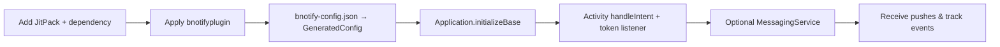
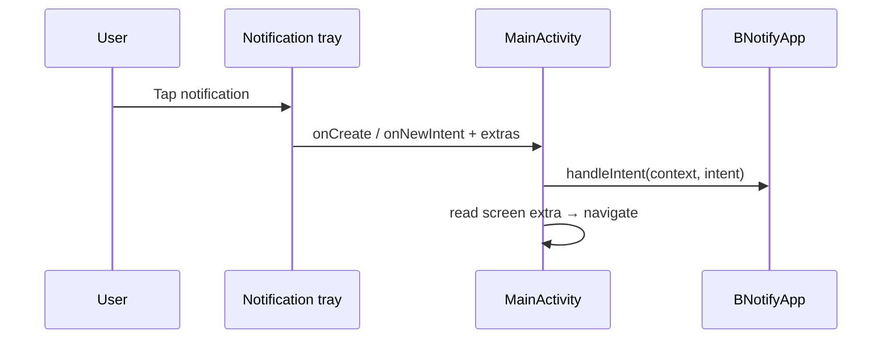
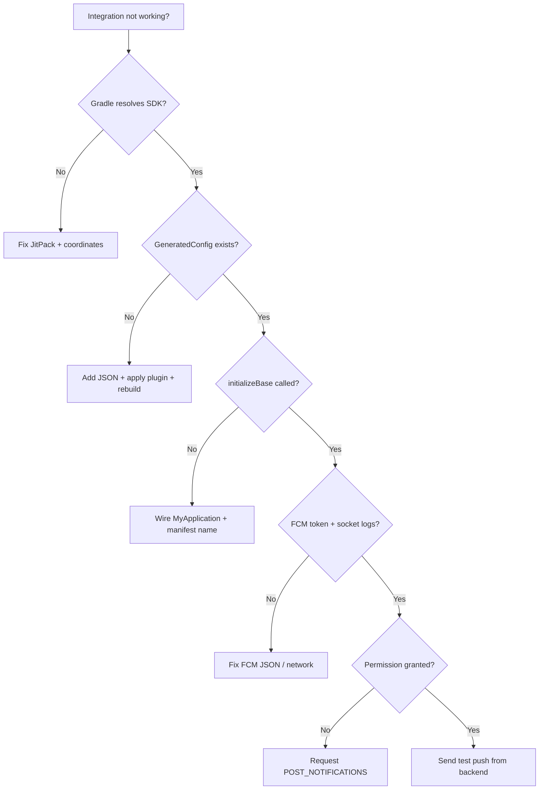

# BNotify Android SDK — Complete Integration Guide

> **Audience:** Android developers integrating BNotify into any app  
> **Artifacts:** `bnotifysdk` (library) + `bnotifyplugin` (Gradle plugin)  
> **Version example:** `1.0.5`  
> **Related:** [documentation.md](documentation.md) (architecture & internals)

This guide shows **exactly how to integrate** the SDK the way production apps do: JitPack repositories, plugin classpath, dependency, config JSON, `Application` init, Activity intent handling, and a custom `BNotifyMessagingService`.

---

## Table of Contents

1. [What You Get After Integration](#1-what-you-get-after-integration)
2. [Prerequisites](#2-prerequisites)
3. [Integration Checklist](#3-integration-checklist)
4. [Step 1 — settings.gradle.kts (repositories)](#4-step-1--settingsgradlekts-repositories)
5. [Step 2 — Project build.gradle.kts (plugin classpath)](#5-step-2--project-buildgradlekts-plugin-classpath)
6. [Step 3 — Module build.gradle.kts (dependency + plugin)](#6-step-3--module-buildgradlekts-dependency--plugin)
7. [Step 4 — Create `app/bnotify-config.json`](#7-step-4--create-appbnotify-configjson)
8. [Step 5 — Application class (`initializeBase`)](#8-step-5--application-class-initializebase)
9. [Step 6 — Register Application in Manifest](#9-step-6--register-application-in-manifest)
10. [Step 7 — MainActivity wiring](#10-step-7--mainactivity-wiring)
11. [Step 8 — Custom `BNotifyMessagingService`](#11-step-8--custom-bnotifymessagingservice)
12. [Step 9 — Notification permission (Android 13+)](#12-step-9--notification-permission-android-13)
13. [Step 10 — Screen / deep routing from payload](#13-step-10--screen--deep-routing-from-payload)
14. [Optional — Auto vs custom notifications](#14-optional--auto-vs-custom-notifications)
15. [Optional — In-App Messaging](#15-optional--in-app-messaging)
16. [Verification & Test Plan](#16-verification--test-plan)
17. [Troubleshooting](#17-troubleshooting)
18. [Production Checklist](#18-production-checklist)
19. [FAQ](#19-faq)
20. [Full Copy-Paste Reference](#20-full-copy-paste-reference)

---

## 1. What You Get After Integration

| Capability | Result |
|------------|--------|
| Device registration | Socket.IO handshake with FCM token + device metadata |
| Push receive | Realtime via Socket.IO (+ optional FCM fallback) |
| System notification UI | Auto-shown by SDK (default) |
| Click / dismiss analytics | Emitted to BNotify server |
| BNotify device token callback | `OnTokenListener.onNewToken` |
| Screen routing | Host reads `screen` extra and opens Activities |
| In-app campaigns | Available when server sends `inapp:show` |



> **Important:** The Android SDK does **not** send pushes by itself. Your **BNotify backend** delivers messages over Socket.IO / FCM. The SDK registers the device and displays / tracks them.

---

## 2. Prerequisites

| Requirement | Notes |
|-------------|--------|
| Android Studio / AGP compatible with Kotlin DSL | Examples use `.kts` |
| `minSdk` ≥ **24** | Matches SDK |
| Internet on device / emulator | Socket + geo IP |
| BNotify project credentials | For `bnotify-config.json` |
| FCM project values | `fcmAppId`, `fcmProjectId`, `fcmApiKey`, `fcmSenderId` |
| Physical device recommended | More reliable for FCM / notifications |

### Values you need from BNotify / Firebase admin

- `projectId`, `appId`, `apiKey`, `packageName`
- FCM: `fcmAppId`, `fcmProjectId`, `fcmApiKey`, `fcmSenderId`
- Optional: `authDomain`, `databaseURL`, `storageBucket`, `messagingSenderId`, `measurementId`

---

## 3. Integration Checklist

| # | Task | Required |
|---|------|----------|
| 1 | Add JitPack to `settings.gradle.kts` | ✅ |
| 2 | Add plugin classpath in project `build.gradle.kts` | ✅ |
| 3 | `implementation` SDK + `apply` plugin in app module | ✅ |
| 4 | Add `app/bnotify-config.json` | ✅ |
| 5 | Sync Gradle → confirm `GeneratedConfig` generated | ✅ |
| 6 | Call `BNotifyApp.initializeBase` in `Application` | ✅ |
| 7 | Register custom `Application` in manifest | ✅ |
| 8 | `handleIntent` + token listener in launcher Activity | ✅ |
| 9 | Subclass `BNotifyMessagingService` + manifest entry | ✅ Recommended |
| 10 | Handle `screen` extras for routing | ⚪ If you use multi-screen pushes |
| 11 | Test push + click on a real device | ✅ |

---

## 4. Step 1 — settings.gradle.kts (repositories)

Add **JitPack** (and keep Google / Maven Central) so Gradle can resolve the SDK and plugin.

```kotlin
pluginManagement {
    repositories {
        google {
            content {
                includeGroupByRegex("com\\.android.*")
                includeGroupByRegex("com\\.google.*")
                includeGroupByRegex("androidx.*")
            }
        }
        mavenCentral()
        gradlePluginPortal()
        maven { url = uri("https://jitpack.io") }
    }
}

dependencyResolutionManagement {
    repositoriesMode.set(RepositoriesMode.FAIL_ON_PROJECT_REPOS)
    repositories {
        google()
        mavenCentral()
        maven { url = uri("https://jitpack.io") }
    }
}
```

> If your project already has `pluginManagement` / `dependencyResolutionManagement`, **merge** the JitPack `maven { url = uri("https://jitpack.io") }` entries — do not duplicate entire blocks incorrectly.

---

## 5. Step 2 — Project build.gradle.kts (plugin classpath)

**File:** root / project-level `build.gradle.kts`

```kotlin
// Top-level build file where you can add configuration options common to all sub-projects/modules.
plugins {
    alias(libs.plugins.android.application) apply false
    alias(libs.plugins.kotlin.android) apply false
}

buildscript {
    repositories {
        maven(url = "https://jitpack.io")
    }
    dependencies {
        // BNotify Gradle plugin (generates GeneratedConfig from bnotify-config.json)
        classpath("com.github.bnotify.bnotifysdk:bnotifyplugin:1.0.5")
        // Flat local-publish fallback (mavenLocal / custom repo):
        // classpath("com.github.bnotify:bnotifyplugin:1.0.5")
    }
}
```

### Note on artifact names

Depending on how the GitHub repo is published to JitPack, coordinates may appear as:

| Form | Example |
|------|---------|
| JitPack multi-module | `com.github.bnotify.bnotifysdk:bnotifysdk:1.0.5` |
| Flat (mavenLocal / custom) | `com.github.bnotify:bnotifysdk:1.0.5` |

Use the coordinate from your release / JitPack build page. Plugin apply id remains:

```text
com.github.bnotifysdk.bnotifyplugin
```

---

## 6. Step 3 — Module build.gradle.kts (dependency + plugin)

**File:** `app/build.gradle.kts` (application module)

```kotlin
plugins {
    alias(libs.plugins.android.application)
    alias(libs.plugins.kotlin.android)
}

android {
    namespace = "com.example.yourapp"
    compileSdk = 36

    defaultConfig {
        applicationId = "com.example.yourapp"
        minSdk = 24
        targetSdk = 36
        // ...
    }
}

dependencies {
    // BNotify Android SDK
    implementation("com.github.bnotify.bnotifysdk:bnotifysdk:1.0.5")

    // your other dependencies...
}

// Apply AFTER android / dependencies blocks as in your project style
apply(plugin = "com.github.bnotifysdk.bnotifyplugin")
```

### What the plugin does on sync/build

1. Reads `app/bnotify-config.json` (must exist under the **root `app/`** directory)
2. Generates:

```text
app/src/main/java/{applicationId}/config/GeneratedConfig.kt
```

3. Hooks generation before `compile*` tasks

If the JSON is missing, Gradle fails with:

```text
❌ No bnotify-config.json found in app directory!
```

---

## 7. Step 4 — Create `app/bnotify-config.json`

**Path (required by plugin):** `{projectRoot}/app/bnotify-config.json`

```json
{
  "projectId": "your-project-id",
  "packageName": "com.example.yourapp",
  "apiKey": "your-api-key",
  "authDomain": "",
  "databaseURL": "",
  "storageBucket": "",
  "messagingSenderId": "",
  "appId": "your-app-id",
  "measurementId": "",
  "fcmAppId": "1:1234567890:android:abcdef",
  "fcmProjectId": "your-firebase-project-id",
  "fcmApiKey": "AIzaSy...",
  "fcmSenderId": "1234567890"
}
```

| Field | Required | Used for |
|-------|----------|----------|
| `projectId` | Yes | Socket / project scope |
| `packageName` | Yes | App identity |
| `apiKey` | Yes | Project auth |
| `appId` | Yes | App identity |
| `fcmAppId` | Yes | Manual Firebase init |
| `fcmProjectId` | Yes | Manual Firebase init |
| `fcmApiKey` | Yes | Manual Firebase init |
| `fcmSenderId` | Yes | Manual Firebase init |
| Others | Optional | Reserved / future |

After a successful Gradle sync/build you should see something like:

```kotlin
package com.example.yourapp.config

object GeneratedConfig {
    val JSON: String? = "{...}"
    val projectId: String? = "..."
    // ...
}
```

Import it in your Application:

```kotlin
import com.example.yourapp.config.GeneratedConfig
```

---

## 8. Step 5 — Application class (`initializeBase`)

Create (or update) your `Application` subclass:

```kotlin
package com.example.yourapp

import android.app.Application
import com.convex.bnotifysdk.BNotifyApp
import com.example.yourapp.config.GeneratedConfig

class MyApplication : Application() {

    override fun onCreate() {
        super.onCreate()

        BNotifyApp.initializeBase(
            this,
            MainActivity::class.java,
            GeneratedConfig.JSON.toString()
        )
    }
}
```

### Signature note

The SDK method is:

```kotlin
fun initializeBase(
    app: Application,
    context: Context,
    activity: Class<out Activity>,
    json: String
)
```

If your published AAR expects **four** arguments (`app`, `context`, `activity`, `json`), call:

```kotlin
BNotifyApp.initializeBase(
    this,
    applicationContext, // or this
    MainActivity::class.java,
    GeneratedConfig.JSON.toString()
)
```

Use the overload that matches the AAR you depend on. Conceptually:

1. Saves config JSON
2. Sets default click Activity (`MainActivity`)
3. Initializes Firebase manually from FCM fields
4. Fetches FCM token
5. Connects Socket.IO
6. Registers `ActivityTracker` for in-app messaging

---

## 9. Step 6 — Register Application in Manifest

**File:** `app/src/main/AndroidManifest.xml`

```xml
<manifest xmlns:android="http://schemas.android.com/apk/res/android">

    <application
        android:name=".MyApplication"
        android:icon="@mipmap/ic_launcher"
        android:label="@string/app_name"
        android:theme="@style/Theme.YourApp">

        <activity
            android:name=".MainActivity"
            android:exported="true"
            android:launchMode="singleTop">
            <intent-filter>
                <action android:name="android.intent.action.MAIN" />
                <category android:name="android.intent.category.LAUNCHER" />
            </intent-filter>
        </activity>

        <!-- Your other activities, e.g. TestActivity -->

        <service
            android:name=".MyNotificationService"
            android:exported="false" />

    </application>
</manifest>
```

Recommendations:

- Use `launchMode="singleTop"` (or `singleTask`) on the Activity that handles notification clicks so `onNewIntent` is called when the app is already open.
- Library merges `INTERNET`, `POST_NOTIFICATIONS`, etc. You usually do not redeclare them unless your policy requires it.

---

## 10. Step 7 — MainActivity wiring

```kotlin
package com.example.yourapp

import android.app.ComponentCaller
import android.content.Context
import android.content.Intent
import android.content.pm.PackageManager
import android.os.Build
import android.os.Bundle
import android.util.Log
import android.widget.TextView
import androidx.appcompat.app.AppCompatActivity
import androidx.core.view.ViewCompat
import androidx.core.view.WindowInsetsCompat
import androidx.activity.enableEdgeToEdge
import com.convex.bnotifysdk.BNotifyApp

class MainActivity : AppCompatActivity() {

    lateinit var txt_version: TextView

    override fun onCreate(savedInstanceState: Bundle?) {
        super.onCreate(savedInstanceState)
        enableEdgeToEdge()
        setContentView(R.layout.activity_main)

        ViewCompat.setOnApplyWindowInsetsListener(findViewById(R.id.main)) { v, insets ->
            val systemBars = insets.getInsets(WindowInsetsCompat.Type.systemBars())
            v.setPadding(systemBars.left, systemBars.top, systemBars.right, systemBars.bottom)
            insets
        }

        txt_version = findViewById(R.id.txt_version)
        val (versionCode, versionName) = getAppVersionInfo(this)
        txt_version.text = "Version $versionName"

        // 1) Forward launch intent (permission + click analytics + service restart)
        BNotifyApp.handleIntent(applicationContext, intent)

        // 2) Listen for BNotify device token (socket "registered")
        BNotifyApp.setOnTokenListener(object : BNotifyApp.OnTokenListener {
            override fun onNewToken(token: String?) {
                Log.d("BNotify_Token", "BNotify Token: $token")
                // Optional: send to your own backend if needed
            }
        })

        // 3) Optional: route by "screen" extra from notification payload
        if (intent.extras != null) {
            val screen = intent.getStringExtra("screen")
            Log.d("Notification_SocketIO", "SCREEN Name: $screen")

            if (screen.equals("home", true)) {
                BNotifyApp.setActivityToOpenOnClick(MainActivity::class.java)
            } else if (screen.equals("Test", true)) {
                BNotifyApp.setActivityToOpenOnClick(TestActivity::class.java)
                startActivity(Intent(this@MainActivity, TestActivity::class.java))
                finish()
            }
        }
    }

    override fun onNewIntent(intent: Intent) {
        super.onNewIntent(intent)
        setIntent(intent)
        Log.d("Notification_SocketIO", "Notification: event: onNewIntent")
        BNotifyApp.handleIntent(applicationContext, intent)

        // Re-run screen routing if needed
        val screen = intent.getStringExtra("screen")
        if (screen.equals("Test", true)) {
            BNotifyApp.setActivityToOpenOnClick(TestActivity::class.java)
            startActivity(Intent(this, TestActivity::class.java))
        }
    }

    // Newer API overload (Android 15+ / when present in your compileSdk)
    override fun onNewIntent(intent: Intent, caller: ComponentCaller) {
        super.onNewIntent(intent, caller)
        Log.d("Notification_SocketIO", "Notification: event: onNewIntent")
        BNotifyApp.handleIntent(applicationContext, intent)
    }

    private fun getAppVersionInfo(context: Context): Pair<Int, String> {
        return try {
            val packageManager = context.packageManager
            val packageName = context.packageName

            val packageInfo = if (Build.VERSION.SDK_INT >= Build.VERSION_CODES.TIRAMISU) {
                packageManager.getPackageInfo(packageName, PackageManager.PackageInfoFlags.of(0))
            } else {
                @Suppress("DEPRECATION")
                packageManager.getPackageInfo(packageName, 0)
            }

            val versionCode = if (Build.VERSION.SDK_INT >= Build.VERSION_CODES.P) {
                packageInfo.longVersionCode.toInt()
            } else {
                @Suppress("DEPRECATION")
                packageInfo.versionCode
            }

            val versionName = packageInfo.versionName ?: "N/A"
            versionCode to versionName
        } catch (e: Exception) {
            e.printStackTrace()
            -1 to "Unknown"
        }
    }
}
```

### Why these calls matter

| Call | Why |
|------|-----|
| `handleIntent` | Requests / checks notification permission path, processes click extras, restarts consumer service |
| `setOnTokenListener` | Gives you the BNotify token after socket registration |
| `setActivityToOpenOnClick` | Updates which Activity future notification taps should open |
| `onNewIntent` | Required when app is already in memory and user taps another notification |



---

## 11. Step 8 — Custom `BNotifyMessagingService`

```kotlin
package com.example.yourapp

import android.app.Activity
import android.util.Log
import com.convex.bnotifysdk.model.NotificationModel
import com.convex.bnotifysdk.services.BNotifyMessagingService

class MyNotificationService : BNotifyMessagingService() {

    override fun activityToOpenOnClick(): Class<out Activity> {
        return MainActivity::class.java
    }

    override fun onMessageReceived(remoteMessage: NotificationModel?) {
        Log.i(
            "BNotify",
            "title: ${remoteMessage?.title} " +
                "message: ${remoteMessage?.message} " +
                "deliveryMethod: ${remoteMessage?.deliveryMethod} " +
                "isExpanded: ${remoteMessage?.isExpanded}"
        )
        // Called when auto-generated notifications are disabled
        // OR when the service listener path is active — use for custom UI / logging
    }
}
```

Declare in the app manifest (see Step 6).

Optional manifest meta-data fallback for click Activity:

```xml
<service
    android:name=".MyNotificationService"
    android:exported="false">
    <meta-data
        android:name="berry.activity_on_click"
        android:value="com.example.yourapp.MainActivity" />
</service>
```

---

## 12. Step 9 — Notification permission (Android 13+)

SDK includes `POST_NOTIFICATIONS` and can open `PermissionRequestActivity` when `handleIntent` runs without permission.

Best practice for UX: also request from your Activity when appropriate:

```kotlin
import android.Manifest
import android.os.Build
import androidx.core.app.ActivityCompat

if (Build.VERSION.SDK_INT >= Build.VERSION_CODES.TIRAMISU) {
    ActivityCompat.requestPermissions(
        this,
        arrayOf(Manifest.permission.POST_NOTIFICATIONS),
        1001
    )
}
```

Without permission, notifications may not appear in the tray on API 33+.

---

## 13. Step 10 — Screen / deep routing from payload

Backend / admin should send a `screen` field in the notification payload. The SDK puts it into the click Intent extras. **Your app** decides navigation.

| `screen` value | Example host behavior |
|----------------|------------------------|
| `home` | Keep / focus `MainActivity` |
| `Test` | Open `TestActivity` |
| custom | Map to any Activity / Fragment route |

`NotificationModel.deepLink` may also be present for custom handling when you disable auto UI or handle in-app CTAs.

---

## 14. Optional — Auto vs custom notifications

**Default:** SDK auto-generates system notifications (`NotificationsManager`).

Disable auto UI if you want full control in `onMessageReceived`:

```kotlin
BNotifyApp.setIsAutoGeneratedNotification(this, false)
```

Then implement your own notification builder inside `MyNotificationService.onMessageReceived` / `OnNotificationListener`, and optionally call:

```kotlin
BNotifyApp.setOnNotificationReceived(model)
BNotifyApp.setOnNotificationClicked(context, intent)
// dismiss PendingIntent via setOnNotificationDismissed(...)
```

---

## 15. Optional — In-App Messaging

After `initializeBase`, `ActivityTracker` registers and can fetch campaigns on foreground (`inapp:fetch`).

Host can also log custom trigger events:

```kotlin
import com.convex.bnotifysdk.inappmessaging.InAppMessenger

InAppMessenger.logEvent("purchase_completed")
```

Campaign types include modal, card, top banner, fullscreen, and image UIs. See [documentation.md](documentation.md#12-in-app-messaging).

---

## 16. Verification & Test Plan

| # | Test | Expected |
|---|------|----------|
| 1 | Gradle Sync | Resolves `bnotifysdk` + plugin from JitPack |
| 2 | Build | `GeneratedConfig.kt` created under `applicationId.config` |
| 3 | Cold start | Log shows FCM token + socket connect |
| 4 | Token listener | `onNewToken` fires with BNotify token |
| 5 | Send push from BNotify admin | Notification appears (permission granted) |
| 6 | Tap notification | `handleIntent` / click analytics; Activity opens |
| 7 | `screen=Test` | Navigates to `TestActivity` |
| 8 | Dismiss notification | Dismiss event emitted (when delete intent wired) |
| 9 | App in background / killed | Still receives via socket service / FCM path as configured |
| 10 | Deny notification permission | No crash; tray may not show |

### Useful log tags

```text
BNotifyApp
BNotify
BNotify_Token
Notification_SocketIO
SocketManager
IP_DATA_INFO
```

---

## 17. Troubleshooting

| Symptom | Likely cause | Fix |
|---------|--------------|-----|
| Cannot resolve dependency | JitPack missing / wrong coordinate | Add JitPack; verify artifact on JitPack page |
| `No bnotify-config.json` | File not under `app/` | Place at `{root}/app/bnotify-config.json` |
| `GeneratedConfig` not found | Plugin not applied / build not run | `apply(plugin = ...)` + Rebuild |
| Wrong package import | `applicationId` mismatch | Import `{applicationId}.config.GeneratedConfig` |
| No FCM token | Bad FCM fields in JSON | Fix `fcm*` values; check Play Services on device |
| Socket never connects | Network / host / config | Check internet; verify `projectId`/`appId`/`apiKey` |
| No notification UI | Permission denied / auto disabled | Grant `POST_NOTIFICATIONS`; check auto flag |
| Tap does nothing | Wrong Activity / no `handleIntent` | Set click Activity; call `handleIntent` in `onCreate`/`onNewIntent` |
| `screen` routing fails | Extra missing / case mismatch | Ensure payload includes `screen`; compare with `equals(..., true)` |
| Duplicate Activities | Missing `singleTop` / not finishing | Use `singleTop` + `setIntent` in `onNewIntent` |



---

## 18. Production Checklist

- [ ] Production `bnotify-config.json` (not debug keys) — keep secrets out of public repos when possible
- [ ] Correct `applicationId` / `packageName` alignment
- [ ] `minSdk` ≥ 24, target/compile SDKs tested
- [ ] Notification icon / channel look correct on OEM devices
- [ ] `MyApplication` registered in release manifest
- [ ] `onNewIntent` + `singleTop` verified for tap-when-foreground
- [ ] Screen map covers all campaign `screen` values you send
- [ ] ProGuard / R8: keep Socket.IO / Gson / Firebase models if minify enabled (add keep rules as needed)
- [ ] Play Console Data safety: disclose push, device IDs, IP/geo if collected
- [ ] Test on Android 13+ permission flow and Android 14/15 behavior

---

## 19. FAQ

**Q: Do I need `google-services.json`?**  
A: The SDK initializes Firebase **manually** from `fcm*` fields in `bnotify-config.json`. You typically do **not** need the Google Services plugin for BNotify init. (You may still add it if the rest of your app uses Firebase.)

**Q: Is `OnTokenListener` the FCM token?**  
A: No. It is the **BNotify** token from the socket `registered` event. FCM token is obtained internally and sent in the socket handshake.

**Q: Who sends the notification?**  
A: Your BNotify backend / dashboard. The SDK receives and displays / tracks it.

**Q: CocoaPods equivalent?**  
A: Android uses **Gradle + JitPack** (or local Maven), not CocoaPods.

**Q: Can I use Groovy `build.gradle` instead of `.kts`?**  
A: Yes — same repositories, classpath, `implementation`, and `apply plugin:` with Groovy syntax.

**Q: Why is plugin JSON path `app/bnotify-config.json`?**  
A: The plugin currently hardcodes the `app` folder under the project root. Keep the file there even in multi-module projects (or adjust the plugin if you fork it).

---

## 20. Full Copy-Paste Reference

### settings.gradle.kts (snippet)

```kotlin
maven { url = uri("https://jitpack.io") } // in pluginManagement + dependencyResolutionManagement
```

### Project build.gradle.kts (snippet)

```kotlin
buildscript {
    repositories {
        maven(url = "https://jitpack.io")
    }
    dependencies {
        classpath("com.github.bnotify.bnotifysdk:bnotifyplugin:1.0.5")
    }
}
```

### App build.gradle.kts (snippet)

```kotlin
implementation("com.github.bnotify.bnotifysdk:bnotifysdk:1.0.5")
apply(plugin = "com.github.bnotifysdk.bnotifyplugin")
```

### Application

```kotlin
BNotifyApp.initializeBase(
    this,
    MainActivity::class.java,
    GeneratedConfig.JSON.toString()
)
```

### Activity

```kotlin
BNotifyApp.handleIntent(applicationContext, intent)
BNotifyApp.setOnTokenListener(object : BNotifyApp.OnTokenListener {
    override fun onNewToken(token: String?) {
        Log.d("BNotify_Token", "BNotify Token: $token")
    }
})
```

### Service

```kotlin
class MyNotificationService : BNotifyMessagingService() {
    override fun activityToOpenOnClick(): Class<out Activity> = MainActivity::class.java
    override fun onMessageReceived(remoteMessage: NotificationModel?) { /* ... */ }
}
```

---

## Related documents

| Document | Purpose |
|----------|---------|
| [documentation.md](documentation.md) | Architecture, classes, socket/FCM flows, models, diagrams |

---

*End of integration guide — BNotify Android SDK (`AndroidSDK/BnotifySDK`).*
